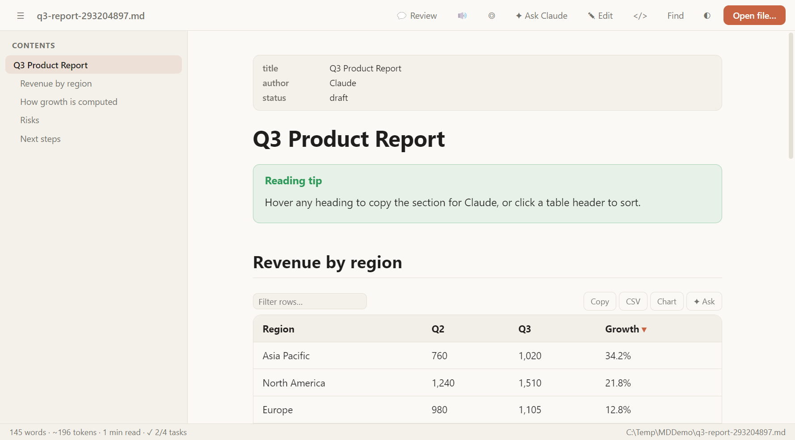
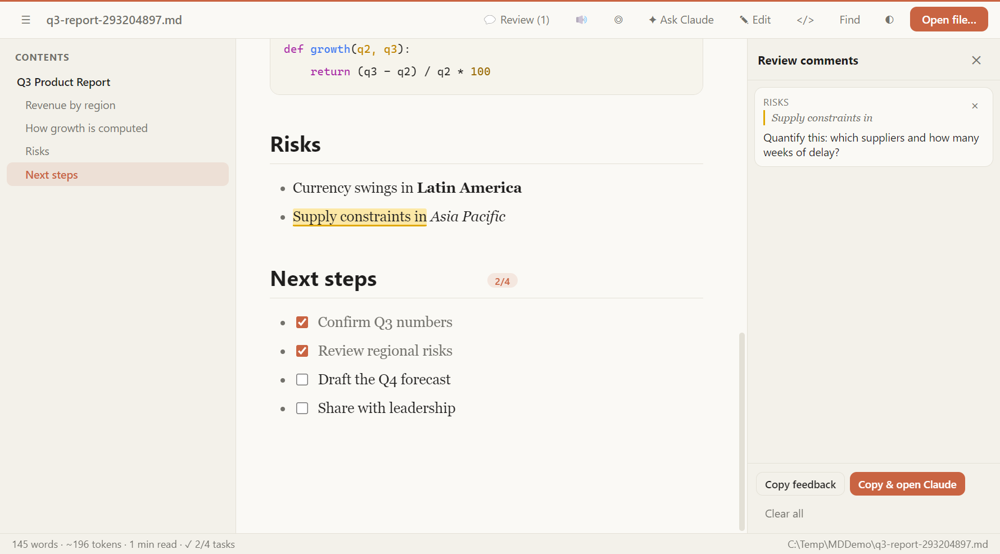
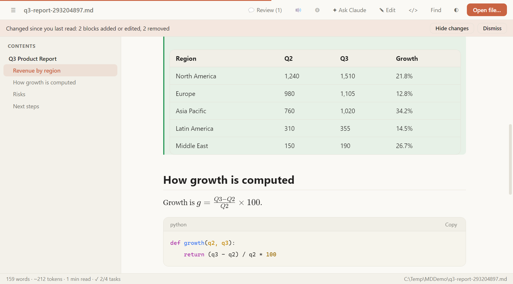

# MD Reader

A Markdown reader and editor for Windows, built for the documents AI tools write: long, table-heavy, constantly rewritten. It renders files the way Claude does, then adds the tools you wish your viewer had.



**[Download the latest installer](../../releases/latest)** (Windows 10/11, no admin rights needed)

> The installer is not code-signed, so Windows SmartScreen may show a warning. Click **More info**, then **Run anyway**.

## What makes it different

| Feature | What it does |
|---|---|
| **Review mode** | Select any text, add a comment, then copy all comments as one structured "please revise" prompt for Claude. |
| **What changed** | When a file is rewritten, a bar shows what changed since you last read it. Added blocks are green, removed blocks are struck through in red. |
| **Live task lists** | Tick a `- [ ]` box and it writes back to the file. Each section shows its progress, such as 2/4. |
| **Table tools** | Sort by clicking a header, filter rows, copy for Excel, save as CSV, or chart the table in one click. |
| **Work with Claude** | Copy any section with its context, or ask Claude about a section, table or selection. |
| **Token estimate** | See roughly how many tokens a document is before you paste it anywhere. |
| **Read aloud and focus mode** | Listen to a document with the current block highlighted, or dim everything except what you hover. |





## Also included

- Claude-style rendering: warm light and dark themes, rounded tables, syntax-highlighted code with copy buttons
- Table of contents sidebar with scroll tracking
- Find with highlighting, match count and case matching (Ctrl+F)
- Editor with live preview, formatting toolbar, list continuation, save and save as
- Tabs, recent files, drag and drop, auto-refresh when a file changes on disk
- Callouts (`> [!TIP]`), math (KaTeX), front matter card, relative links and images
- Export to PDF or HTML, source view, wide layout

## Keyboard shortcuts

| Shortcut | Action |
|---|---|
| Ctrl+O / Ctrl+N / Ctrl+S | Open, new, save |
| Ctrl+E | Toggle editor |
| Ctrl+F | Find |
| Ctrl+\ | Toggle contents |
| Ctrl+/ | Source view |
| Ctrl+D | Dark mode |
| Ctrl+W, Ctrl+Tab | Close tab, next tab |
| Ctrl+B / Ctrl+I / Ctrl+K | Bold, italic, link (in the editor) |

## Build from source

Requires [Node.js](https://nodejs.org) 20 or newer.

```bash
git clone https://github.com/fiifikaasiebrew/md-reader.git
cd md-reader
npm install
npm start          # run the app
npm run dist       # build the Windows installer into dist/
```

Built with Electron, [marked](https://github.com/markedjs/marked), [highlight.js](https://highlightjs.org) and [KaTeX](https://katex.org).

## Author

Created by **Fiifi Kaasie Brew**.

## License

[MIT](LICENSE) &copy; 2026 Fiifi Kaasie Brew
